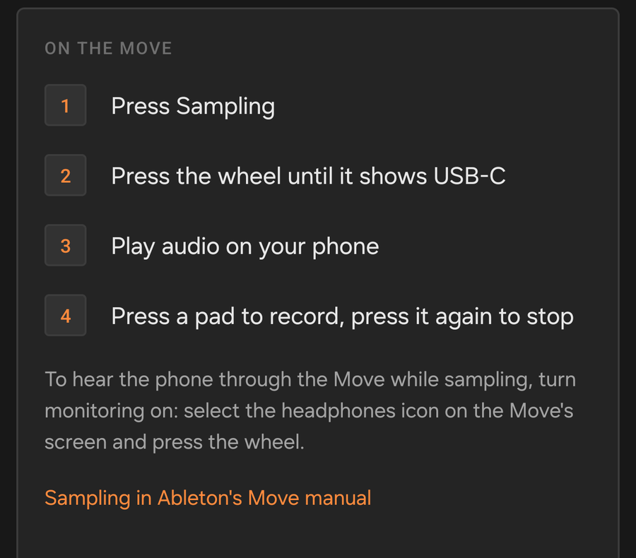
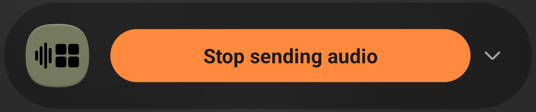
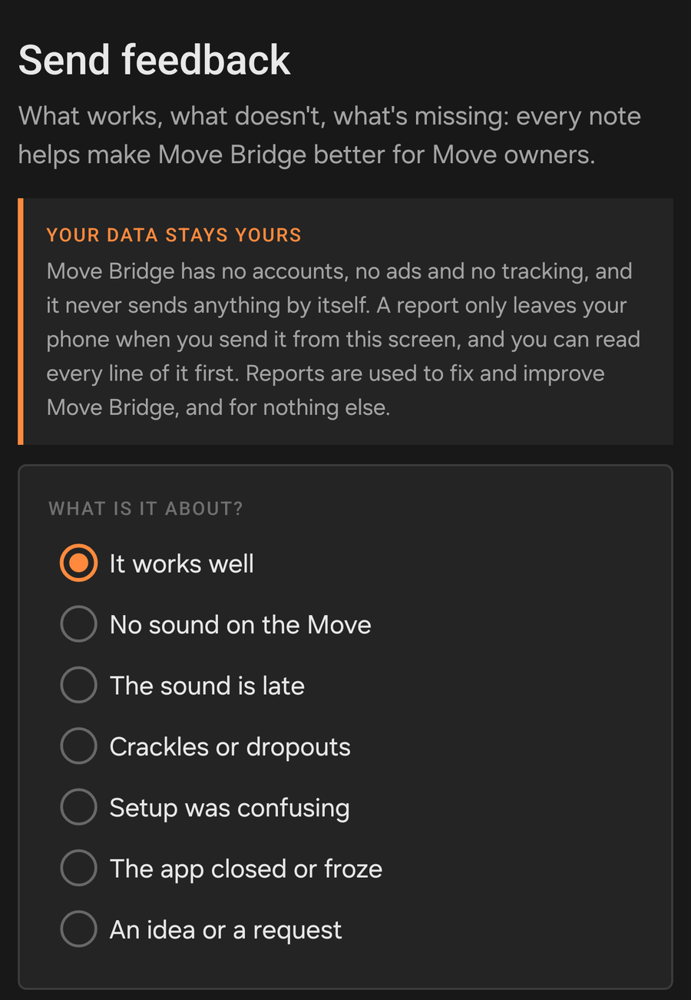

# Move Bridge

**Play your Android phone's sound into an Ableton Move over a USB-C cable, and sample it.**

iPhones do this out of the box. Most Android phones only see the Move as a MIDI controller, so nothing you play on the phone reaches it. Move Bridge fixes that: music apps, sample libraries, videos, games, anything the phone plays can be recorded on a pad.

Move Bridge is free, open source and in **beta**. It has no accounts, no ads and no tracking.

> Ableton and Move are trademarks of Ableton AG. Move Bridge is an independent project and is not affiliated with, sponsored by or endorsed by Ableton.

## What you need
- An Ableton Move.
- A USB-C to USB-C **data** cable (a charge-only cable won't work), plugged straight into the phone.
- An Android phone with Android 10 or newer.

## Install
1. On your phone, open the [latest release](https://github.com/rene415/move-bridge/releases/latest) and download `MoveBridge-x.y.apk`.
2. Open the downloaded file. Android asks whether your browser may install apps: allow it, then tap **Install**.
3. Open Move Bridge once and allow the two things it asks for (audio and notifications).

To update, install a newer APK the same way. Your settings are kept, and the app shows what's new.

## Use
1. Plug the Move into the phone. Android asks whether to open Move Bridge: tick **Always** and confirm.
2. Tap **Start sending audio**. Android shows its capture prompt: tap **Start**. Android calls this "sharing your screen", but Move Bridge only takes the sound, never the screen.
3. On the Move: press **Sampling**, then press the wheel until the input shows **USB-C**. The Move remembers this for next time.
4. Play something on the phone.
5. Press a pad to start recording and press it again to stop. Or hold a pad and let go.

To hear the phone through the Move while sampling, turn monitoring on: select the headphones icon on the Move's screen and press the wheel. It is off by default.

Ableton's manual has pictures of these screens: [Selecting a sampling input source](https://www.ableton.com/en/move/manual/#selecting-a-sampling-input-source) and [Sampling audio via USB-C](https://www.ableton.com/en/move/manual/#sampling-audio-via-usb-c).

To stop: tap **Stop sending audio** in the notification or in the app. Unplugging stops it too.

Good to know:
- Your phone plays along. To hear only the Move, switch off **Also play on phone**.
- The Move always gets the full level, whatever the phone's volume is.
- While sending, Android shows its capture icon and may hide the contents of notifications. That is Android's rule for any capture.
- Apps that block capture (some streaming services) come through silent.

## Settings
| Setting | What it does |
|---|---|
| **Start when Move connects** | Plug in and sending starts, with only Android's prompt in between. |
| **Mute notifications while sending** | Puts the phone on vibrate while sending, so rings and pings don't land in your samples. Alarms still sound. |
| **Also play on phone** | On: your phone plays along. Off: only the Move plays (Move Bridge turns the phone's own volume to zero while sending). |
| **Stay ready in background** | Approve Android's prompt once, and Move Bridge stays ready for the next plug-in until the phone restarts. |
| **Advanced mode** | For tinkerers: a lower-delay direct connection. See below. |

There is also a Quick Settings tile ("Move Bridge") to start and stop from the pull-down panel.

## Advanced mode (optional)
Advanced mode makes Android play straight to the Move, like USB-C headphones. It needs a one-time setup in Android's Developer options, so it is off unless you switch it on.

What it gains, measured on our test phone:

| | Regular | Advanced |
|---|---|---|
| Instrument or game app, while playing | about 130 ms delay | about 25 ms |
| Music or video app, pressing play | about 220 ms | about 125 ms |
| Starting | Android's capture prompt | nothing to tap |

If you play instruments into the Move, it is worth it. If you sample from music and video apps, Regular does the job. The full comparison is in [docs/regular-vs-advanced.md](docs/regular-vs-advanced.md), and the setup in [docs/advanced.md](docs/advanced.md).

## Feedback
This is a beta, and your feedback decides what gets fixed next. In the app, tap **Send feedback**: pick what it's about, write a line or two, and send it. The app never sends anything by itself, and you can read the whole report before it goes out.

You can also [open an issue](https://github.com/rene415/move-bridge/issues/new/choose) here on GitHub. Helpful things to mention: your phone model and Android version, which app you were playing from, and whether the **test tone** reaches the Move.

Tested so far on a Samsung Galaxy S26 Ultra with Android 17. Reports from other phones are very welcome.

## Privacy
No accounts, no ads, no analytics, no tracking. Nothing leaves your phone unless you send a report yourself. Full details: [PRIVACY.md](PRIVACY.md).

## License
Move Bridge is licensed under the [Apache License 2.0](LICENSE). The open-source code it builds on is listed in [THIRD_PARTY_NOTICES.md](THIRD_PARTY_NOTICES.md); the same notices are in the app under **Open-source licenses**.

Building from source and how it works: [docs/advanced.md](docs/advanced.md).
