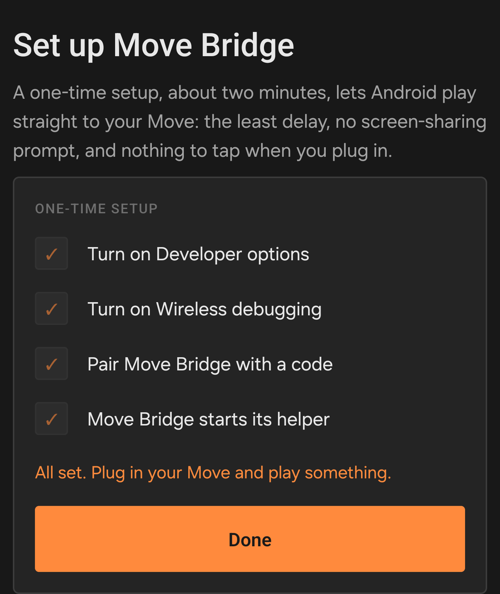
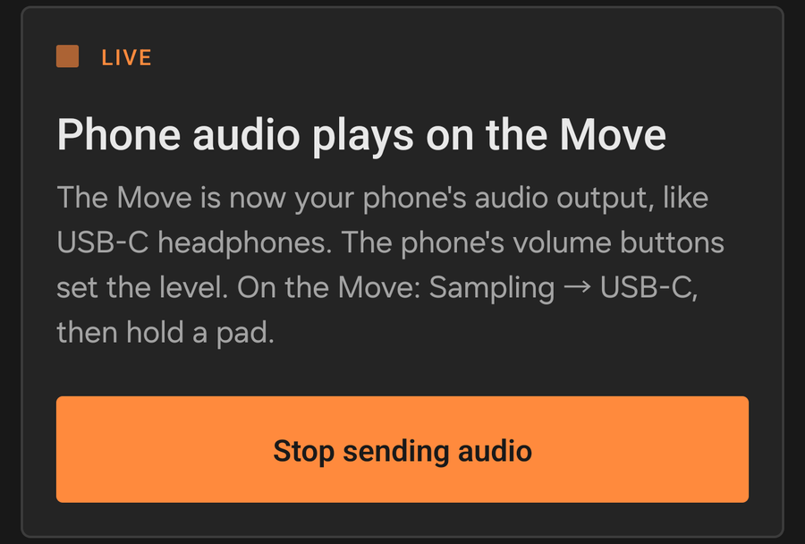
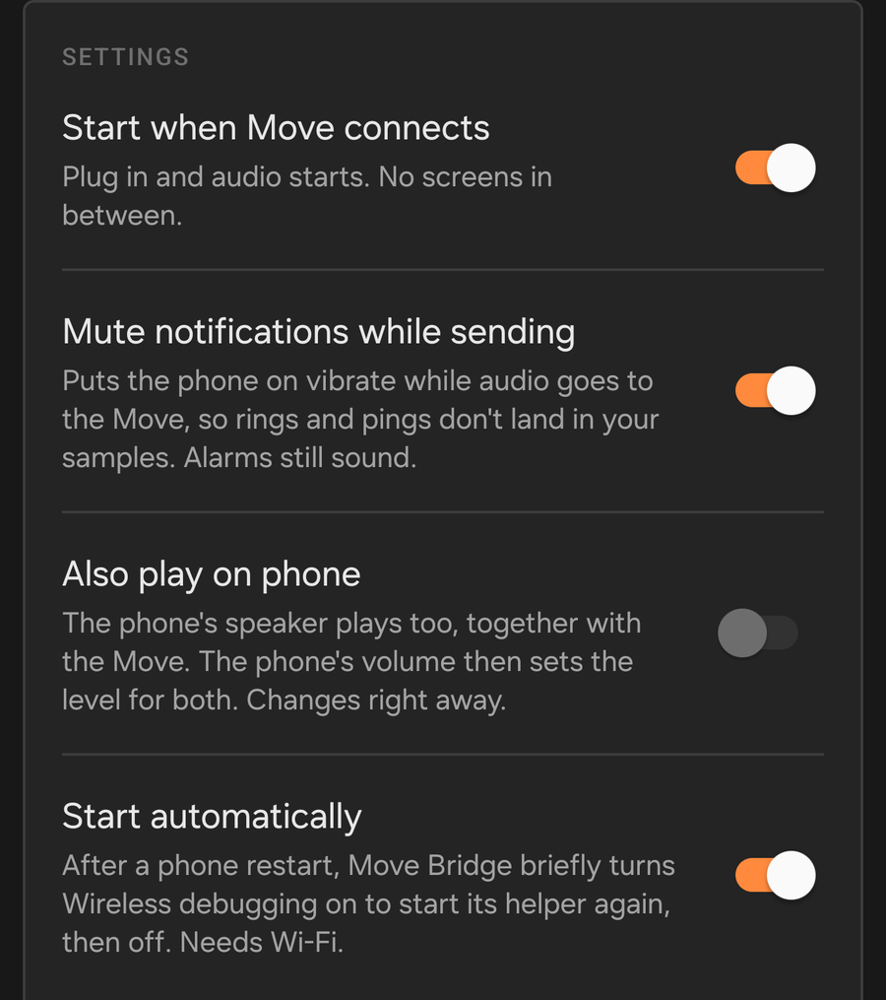

# Move Bridge

**Play your Android phone's sound into an Ableton Move over a USB-C cable, and sample it.**

iPhones do this out of the box. Most Android phones only see the Move as a MIDI controller, so nothing you play on the phone reaches it. Move Bridge fixes that: music apps, sample libraries, videos, games, anything the phone plays can be recorded on a pad.

Move Bridge is free, open source and in **beta**. It has no accounts, no ads and no tracking.

> Ableton and Move are trademarks of Ableton AG. Move Bridge is an independent project and is not affiliated with, sponsored by or endorsed by Ableton.

## What you need
- An Ableton Move.
- A USB-C to USB-C **data** cable (a charge-only cable won't work), plugged straight into the phone.
- An Android phone with Android 10 or newer. Android 13 or newer gets the best mode (Direct).

## Install
1. On your phone, open the [latest release](https://github.com/rene415/move-bridge/releases/latest) and download `MoveBridge-x.y.apk`.
2. Open the downloaded file. Android asks whether your browser may install apps: allow it, then tap **Install**.
3. Open Move Bridge. The first time, it shows a short setup guide.

To update, install a newer APK the same way. Your settings are kept, and the app shows what's new.

## One-time setup (recommended, Android 13+, about two minutes)
The setup lets Android play straight to the Move, with no "share your screen" prompt. The app's **Setup guide** walks you through it and ticks each step off:

1. **Turn on Developer options:** Settings → About phone → Software information → tap **Build number** 7 times.
2. **Turn on Wireless debugging:** Settings → Developer options → **Wireless debugging** → on. The phone must be on Wi-Fi. Tap **Allow**.
3. **Pair:** in Wireless debugging, tap **Pair device with pairing code**. Keep that screen open, pull down your notifications, and type the 6-digit code into the Move Bridge notification.
4. Move Bridge starts its helper. Done.



Why Developer options? Android only lets its own debugging service start the small helper that Move Bridge needs to route audio. Move Bridge connects only to the phone itself, never to another device. You can skip the setup: the app then uses Android's screen-share permission instead (see Bridge mode below).

## Use
1. Plug the Move into the phone. Sending starts by itself.

   

2. On the Move: press **Sampling**, then press the wheel until the input shows **USB-C**. The Move remembers this for next time.
3. Play something on the phone.
4. Press a pad to start recording and press it again to stop. Or hold a pad and let go.

   

To hear the phone through the Move while sampling, turn monitoring on: select the headphones icon on the Move's screen and press the wheel. It is off by default.

Ableton's manual has pictures of these screens: [Selecting a sampling input source](https://www.ableton.com/en/move/manual/#selecting-a-sampling-input-source) and [Sampling audio via USB-C](https://www.ableton.com/en/move/manual/#sampling-audio-via-usb-c).

To stop: tap **Stop sending audio** in the notification, in the app, or on the Quick Settings tile. Unplugging stops it too.


## Settings
| Setting | What it does |
|---|---|
| **Start when Move connects** | Plug in and audio starts, with no screens in between. |
| **Mute notifications while sending** | Puts the phone on vibrate while sending, so rings and pings don't land in your samples. Alarms still sound. |
| **Also play on phone** | The phone's speaker plays too, together with the Move. Shown once the setup is done. |
| **Start automatically** | After a phone restart, Move Bridge turns Wireless debugging on for a moment by itself to start its helper again, then off. Needs Wi-Fi. Shown once the setup is done. |
| **Stay ready in background** | Only without the setup: keeps the screen-share permission between plug-ins. |

There is no switch for *how* the audio gets to the Move. Move Bridge always uses the best way your phone can do right now (see below). If the one-time setup isn't done, or Wireless debugging is needed once after a restart, the settings show a line that says so; tap it.



## The two ways it sends audio
Move Bridge picks by itself:
- **Direct** (with the one-time setup, always used when possible): Android itself plays to the Move, like USB-C headphones. Nothing is captured, the phone's volume buttons set the level, and the Move's MIDI keeps working on the phone.
- **Bridge** (any Android 10+ phone, and the fallback): Move Bridge captures what the phone plays and sends it to the Move's USB audio input itself. Without the setup this uses Android's screen-share permission; only audio is taken, never the screen.

Delay, measured on a Samsung Galaxy S26 Ultra (your phone will differ; the app shows its own measurement under **Connection details**):

| | Tap-to-hear | While playing |
|---|---|---|
| Direct, instrument and game apps | about 40 ms | about 25 ms |
| Direct, music and video apps | about 120-185 ms | about 210 ms (video stays in sync) |
| Bridge | about 80 ms | about 150-170 ms |

Android itself sets these numbers. Details: [docs/latency-and-direct-route.md](docs/latency-and-direct-route.md).

## Known limits
- With Direct, everything Android plays goes to the Move, notification sounds included (and normally phone calls too). Use **Mute notifications while sending** to keep pings out.
- With Bridge, apps that block capture (some streaming services) come through silent.
- Developer options have to stay enabled for Direct. After a phone restart the helper has to start again: automatically with **Start automatically**, or when you turn Wireless debugging on once.
- Tested so far on a Samsung Galaxy S26 Ultra with Android 17. Reports from other phones are very welcome.

## Feedback
This is a beta, and your feedback decides what gets fixed next. In the app, tap **Send feedback**: pick what it's about, write a line or two, and send it. The app never sends anything by itself, and you can read the whole report before it goes out.


You can also [open an issue](https://github.com/rene415/move-bridge/issues/new/choose) here on GitHub. Helpful things to mention: your phone model and Android version, which app you were playing from, and whether the **test tone** reaches the Move.

## Privacy
No accounts, no ads, no analytics, no tracking. Nothing leaves your phone unless you send a report yourself. Full details: [PRIVACY.md](PRIVACY.md).

## Build from source (Windows)
Needs JDK 17 and the Android SDK with platform 36, **NDK 28.2.13676358** and CMake 3.22.1. Put the SDK path in `local.properties` (`sdk.dir=...`).

```powershell
$env:JAVA_HOME = "<path to JDK 17>"
.\gradlew.bat lintRelease assembleRelease
```

The APK lands in `app/build/outputs/apk/release/app-release.apk`. Without a `keystore.properties` file the build is signed with your machine's debug key, which can't update an install made from the official releases (uninstall that first).

The code follows two house rules: no function longer than 25 lines, and zero warnings (C++ `-Werror`, Kotlin `allWarningsAsErrors`, lint `warningsAsErrors`).

Logs: `adb logcat -s MoveBridge`.

## License
Move Bridge is licensed under the [Apache License 2.0](LICENSE). The open-source code it builds on is listed in [THIRD_PARTY_NOTICES.md](THIRD_PARTY_NOTICES.md); the same notices are in the app under **Open-source licenses**.

## How it works
- [docs/move-usb-descriptor.md](docs/move-usb-descriptor.md): the Move's USB interfaces and the streaming handshake.
- [docs/audio-only-capture.md](docs/audio-only-capture.md): the helper, and capture without screen sharing.
- [docs/latency-and-direct-route.md](docs/latency-and-direct-route.md): why Android shows the Move as MIDI only, Direct mode, and the measurements.
- [CHANGELOG.md](CHANGELOG.md): what changed in each version.
