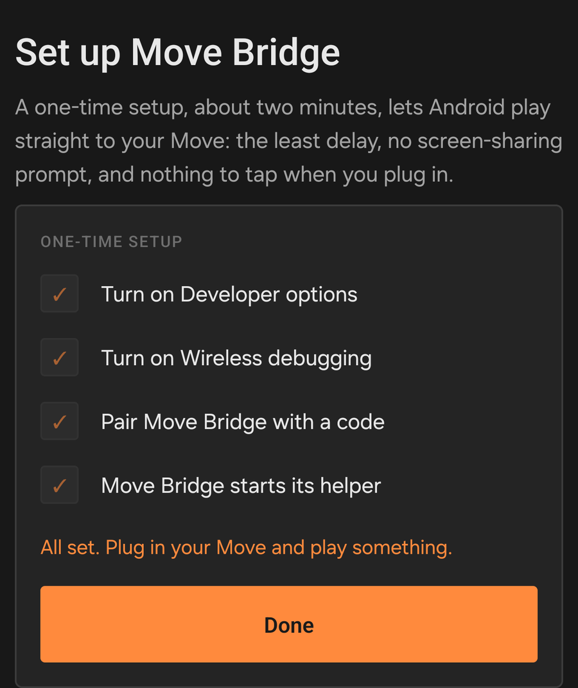
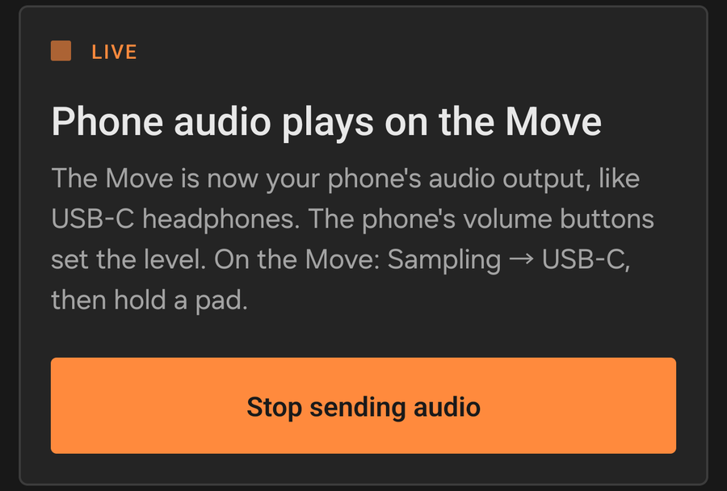
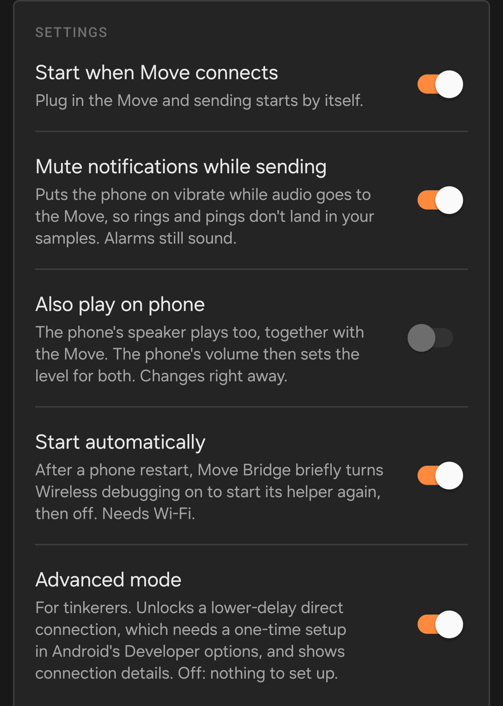

# Advanced mode

Everything on this page is optional. Move Bridge works without it; see the [README](../README.md).

## What it gives you
With Advanced mode on and its one-time setup done, Android itself plays to the Move, like USB-C headphones or an iPhone:
- **Less delay**, most of all in instrument and game apps.
- **No capture prompt**, no capture icon, and notifications stay visible.
- **The phone can stay silent** ("Also play on phone" becomes a real switch).
- The phone's volume buttons set the level, and the Move's MIDI keeps working on the phone.

Delay, measured on a Samsung Galaxy S26 Ultra (your phone will differ; the app shows its own measurement under **Connection details**):

| | Tap-to-hear | While playing |
|---|---|---|
| Advanced, instrument and game apps | about 40 ms | about 25 ms |
| Advanced, music and video apps | about 120-185 ms | about 210 ms (video stays in sync) |
| Basic sending | about 80 ms | about 150-170 ms |

Android itself sets these numbers. Details: [latency-and-direct-route.md](latency-and-direct-route.md).

## What it costs
- It needs Android 13 or newer and a one-time setup in Android's **Developer options**.
- Developer options have to stay enabled.
- After a phone restart the app's helper has to start again: by itself with **Start automatically**, or when you turn Wireless debugging on once.
- Everything Android plays goes to the Move, notification sounds included (and normally phone calls too). **Mute notifications while sending** keeps pings out.

## The one-time setup (about two minutes)
In Move Bridge, switch on **Settings → Advanced mode**. The setup guide opens and ticks each step off:

1. **Turn on Developer options:** Settings → About phone → Software information → tap **Build number** 7 times.
2. **Turn on Wireless debugging:** Settings → Developer options → **Wireless debugging** → on. The phone must be on Wi-Fi. Tap **Allow**.
3. **Pair:** in Wireless debugging, tap **Pair device with pairing code**. Keep that screen open, pull down your notifications, and type the 6-digit code into the Move Bridge notification.
4. Move Bridge starts its helper. Done.



Why Developer options? Android only lets its own debugging service start the small helper that Move Bridge needs to route audio. Move Bridge connects only to the phone itself, never to another device.

From then on, plugging in the Move starts sending by itself:



## What Advanced mode adds to the app
| | |
|---|---|
| **Also play on phone** | A real switch: off sends to the Move only, on plays on both together. |
| **Start automatically** | After a phone restart, Move Bridge turns Wireless debugging on for a moment by itself to start its helper again, then off. Needs Wi-Fi, and only acts on the Wi-Fi network where the setup was done. |
| **Connection details** | What route is in use and the delay measured on your phone. |
| **Setup guide** | The four steps above, any time. |
| A line in Settings | Only when something needs doing: the setup isn't finished, or Wireless debugging is needed once after a restart. |



If the direct connection can't start, Move Bridge falls back by itself: first to capturing through its helper, then to basic sending.

Switching Advanced mode off returns the app to basic sending. The pairing stays on the phone, so switching it on again needs no new setup.

## Build from source (Windows)
Needs JDK 17 and the Android SDK with platform 36, **NDK 28.2.13676358** and CMake 3.22.1. Put the SDK path in `local.properties` (`sdk.dir=...`).

```powershell
$env:JAVA_HOME = "<path to JDK 17>"
.\gradlew.bat lintRelease assembleRelease
```

The APK lands in `app/build/outputs/apk/release/app-release.apk`. Without a `keystore.properties` file the build is signed with your machine's debug key, which can't update an install made from the official releases (uninstall that first).

The code follows two house rules: no function longer than 25 lines, and zero warnings (C++ `-Werror`, Kotlin `allWarningsAsErrors`, lint `warningsAsErrors`).

Logs: `adb logcat -s MoveBridge`.

## How it works
- [move-usb-descriptor.md](move-usb-descriptor.md): the Move's USB interfaces and the streaming handshake.
- [audio-only-capture.md](audio-only-capture.md): the helper, and working without screen sharing.
- [latency-and-direct-route.md](latency-and-direct-route.md): why Android shows the Move as MIDI only, the direct connection, and the measurements.
- [releasing.md](releasing.md): how a release is made.
- [../CHANGELOG.md](../CHANGELOG.md): what changed in each version.
